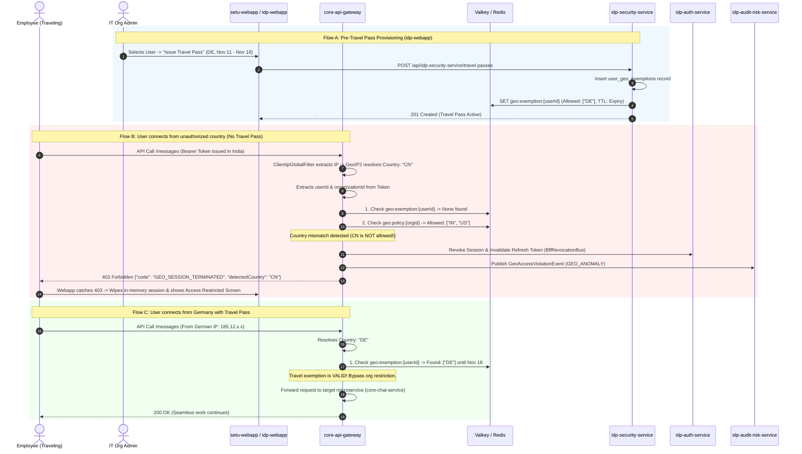

# Enterprise Blueprint: Continuous Geo-Fencing, Real-Time Revocation & Travel Pass Architecture

## 1. Executive Summary & Problem Scope

This document defines the complete industry-standard architecture for **Continuous Geo-Evaluation, Real-Time Cross-Border Session Revocation, and Temporary Travel Passes** for the Setu and IDP ecosystem.

### The Real-World Challenge:
In a modern mobile workforce, users move across borders:
1. **The In-Flight / Border Crossing Scenario:** An employee logs in from an authorized location (e.g., India). They receive an active session and JWT tokens. Hours later, they land in an unauthorized or restricted location (e.g., China or Russia), or activate an unauthorized VPN. **If evaluation only happened at the login page, the user would remain logged in indefinitely.**
2. **The Legitimate Business Traveler Scenario:** An executive or sales engineer travels to Germany or Japan for a client conference. Their company allowlist only permits India and the US. **Without an enterprise Travel Pass mechanism, the legitimate employee is completely locked out of work.**
3. **The Account Theft / Impossible Travel Scenario:** A user's token is copied/stolen by malware and used in Frankfurt 20 minutes after the legitimate user logged in from Mumbai.

### Industry Benchmark Standard:
| Capability | Microsoft Entra ID (Azure AD) | Okta Identity Engine | Google BeyondCorp | **Setu Enterprise Architecture (Target)** |
|---|---|---|---|---|
| **Real-Time Evaluation** | Continuous Access Evaluation (CAE / RFC 8693) | Real-Time Context Engine | Context-Aware Envoy Filter | **Gateway WebFlux Filter on every API call (< 0.5ms)** |
| **Active Session Killing** | Revocation bus pushes token invalidation to STS | Event Hooks & Session Invalidation | Google Front End (GFE) session terminate | **`BffRevocationBus` + Redis token blacklisting** |
| **Travel Exemption** | Temporary Access Pass & Named Location Exclusions | Dynamic Network Zone User Exclusions | Access Level User Binding | **Time-Bound `user_geo_exemptions` with Redis cache** |
| **Self-Service Travel Request**| Identity Governance Access Packages | Okta Access Requests workflow | Approval Request workflow | **Employee request flow with Admin 1-click approval** |
| **Anomaly Engine** | Atypical Travel Velocity Check | Impossible Travel Detection | Anomaly Risk Engine | **`idp-audit-risk-service` Haversine velocity calculation** |

---

## 2. End-to-End System Architecture



---

## 3. The Gateway Evaluation Precedence (The Exact Rule Hierarchy)

To guarantee both **zero latency** and **airtight security**, `core-api-gateway` evaluates every incoming HTTP request against this strict precedence order:

```
                      [ Incoming API Request ]
                                 │
                                 ▼
           [ 1. Is it a public path or health check? ]
                        ├─── YES ───► ALLOW
                        └─── NO
                                 │
                                 ▼
           [ 2. Is IP a private RFC 1918 internal IP? ]
           (10.0.0.0/8, 172.16.0.0/12, 192.168.0.0/16, 127.0.0.1)
                        ├─── YES ───► ALLOW (if allowInternalIps is true)
                        └─── NO
                                 │
                                 ▼
           [ 3. Is user a Break-Glass Emergency Admin? ]
                        ├─── YES ───► ALLOW (if bypassAdminEmergency is true)
                        └─── NO
                                 │
                                 ▼
           [ 4. Does user have an ACTIVE Travel Pass? ]
           (Fast Redis lookup: geo:exemption:{userId})
                        ├─── YES (Country matches exemption) ───► ALLOW
                        └─── NO
                                 │
                                 ▼
           [ 5. Evaluate Organization Geo-Policy ]
           (Fast Redis lookup: geo:policy:{orgId})
                        ├─── Matches Allowed Countries ─────────► ALLOW
                        └─── Restricted Country Detected
                                 │
                                 ▼
               [ 6. Execute Policy Action ]
                        ├─── Action = HARD_BLOCK
                        │       ├── Revoke active session in Redis
                        │       ├── Publish event to idp-audit-risk-service
                        │       └── Return 403 GEO_SESSION_TERMINATED
                        │
                        └─── Action = REQUIRE_MFA
                                └── Return 403 GEO_MFA_STEPUP_REQUIRED
```

---

## 4. The Enterprise Travel Pass System

### A. What is a Travel Pass?
A **Travel Pass** is a temporary, time-bound, cryptographically auditable exemption granted to a specific user. It allows that user to connect from one or more specified foreign countries for a limited window of time.

### B. Travel Pass Lifecycle:
1. **Creation:**
   - **Admin-Initiated:** Org Admin or Security Manager creates it via `idp-webapp` under **User Details $\rightarrow$ Security $\rightarrow$ Travel Pass**.
   - **Self-Service Request (Optional):** Employee submits a travel request from `setu-webapp`:
     > *"Traveling to Munich, Germany for Client Conference from Nov 11 to Nov 18. Requesting Setu access from Germany."*
     > Manager receives notification and clicks **[Approve Travel Pass]**.
2. **Immediate Activation:**
   - Record inserted into PostgreSQL table `user_geo_exemptions`.
   - Written immediately to Redis key `geo:exemption:{userId}` with exact TTL matching the expiry timestamp.
3. **Automatic Expiry & Deprovisioning:**
   - When the timestamp expires:
     - The Redis key expires automatically (TTL = 0).
     - The database record status updates to `EXPIRED`.
     - Future requests from that country are immediately blocked without needing manual admin intervention.
4. **Early Revocation:**
   - If an employee returns early or their device is lost/stolen during travel, the Admin can click **"Revoke Travel Pass Immediately"**. The Redis key is deleted instantly.

---

## 5. Token Refresh & Active Session Revocation Pipeline

When a user moves across the border into a restricted country with an active session, two attack vectors must be closed:
1. **The Active Access Token Vector:** Handled by the Gateway's per-request filter returning `403 GEO_SESSION_TERMINATED`.
2. **The Background Silent Token Refresh Vector:** 
   - Browsers running single-page apps (SPAs) periodically call `/api/idp-auth-service/refresh-token` or use BFF refresh cookies to get new 15-minute access tokens silently.
   - **The Defense:**
     - The gateway stamps `X-Client-Country` on the refresh request.
     - `idp-auth-service` / `BffSessionRelayFilter` evaluates the country **before** rotating the refresh token.
     - If the refresh request originates from a non-allowed country (and no Travel Pass exists), `idp-auth-service` immediately deletes the refresh token from `refresh_tokens` and Valkey/Redis, permanently killing the session.

---

## 6. Impossible Travel Anomaly Detection (`idp-audit-risk-service`)

When traveling across borders, we must distinguish between:
- **Normal Human Travel:** User logs off in India at 8:00 AM $\rightarrow$ 14 hours later lands in London and connects $\rightarrow$ Velocity ~600 km/h (Normal airplane flight).
- **Impossible Travel (Credential Theft / VPN Jumping):** User makes an API call from Mumbai at 2:00 PM $\rightarrow$ 15 minutes later makes an API call from Tokyo $\rightarrow$ Velocity ~24,000 km/h (Physically impossible).

### The Mathematical Formula:
The service calculates physical travel velocity using the Haversine Great-Circle distance between the two coordinates:
$$d = 2R \cdot \arcsin\left(\sqrt{\sin^2\left(\frac{\Delta \phi}{2}\right) + \cos(\phi_1)\cos(\phi_2)\sin^2\left(\frac{\Delta \lambda}{2}\right)}\right)$$
$$\text{Velocity} = \frac{\text{Distance } (km)}{\Delta t \text{ (hours)}}$$

- If $\text{Velocity} > 900 \text{ km/h}$:
  1. Records `RiskEventEntity` with `RiskEventEnum.IMPOSSIBLE_TRAVEL` (Severity: `CRITICAL`).
  2. Dispatches Kafka message to `BffRevocationBus` to **instantly terminate all active sessions across all devices**.
  3. Locks account and requires password reset + MFA verification.

---

## 7. Database Schemas & Data Contracts

### A. Database Migration: `V3__user_geo_exemptions.sql` (`idp-security-service`)

```sql
-- 1. Travel Pass Exemption Status Enum
DO $$ BEGIN
    IF NOT EXISTS (SELECT 1 FROM pg_type WHERE typname = 'geo_exemption_status') THEN
        CREATE TYPE geo_exemption_status AS ENUM ('ACTIVE', 'EXPIRED', 'REVOKED');
    END IF;
END $$;

-- 2. User Travel Pass Exemptions Table
CREATE TABLE IF NOT EXISTS user_geo_exemptions (
    id UUID PRIMARY KEY DEFAULT gen_random_uuid(),
    user_id UUID NOT NULL,
    organization_id UUID NOT NULL,
    country_code VARCHAR(2) NOT NULL,        -- ISO 3166-1 alpha-2, e.g. "DE", "JP"
    country_name VARCHAR(100) NOT NULL,
    start_time TIMESTAMPTZ NOT NULL,
    end_time TIMESTAMPTZ NOT NULL,
    reason TEXT NOT NULL,                     -- e.g. "Attending AWS Summit in Berlin"
    status geo_exemption_status NOT NULL DEFAULT 'ACTIVE',
    created_at TIMESTAMPTZ NOT NULL DEFAULT NOW(),
    created_by UUID NOT NULL,                 -- Admin who approved/created it
    revoked_at TIMESTAMPTZ,
    revoked_by UUID,
    CONSTRAINT fk_exemption_org FOREIGN KEY (organization_id) REFERENCES organizations(id) ON DELETE CASCADE
);

CREATE INDEX idx_user_geo_active ON user_geo_exemptions(user_id, status, start_time, end_time);
```

### B. Redis Caching Specification

#### Key: `geo:exemption:{userId}`
- **Data Structure:** Hash or JSON String.
- **Content:**
  ```json
  {
    "userId": "c71a82e0-291b-4f81-8173-9a0d8e123456",
    "organizationId": "a90f1d2e-3c4b-5a6f-7e8d-9c0b1a2d3e4f",
    "allowedCountries": ["DE", "FR"],
    "validUntil": "2026-11-18T23:59:59Z"
  }
  ```
- **TTL:** Set to `(end_time - current_time)` in seconds. Redis automatically purges the key the second the pass expires.

---

### C. Admin REST API Specification (`idp-security-service`)

#### 1. Issue Travel Pass:
- `POST /api/idp-security-service/organizations/{orgId}/users/{userId}/travel-passes`
  - Request Body:
    ```json
    {
      "countryCode": "DE",
      "countryName": "Germany",
      "startTime": "2026-11-11T00:00:00Z",
      "endTime": "2026-11-18T23:59:59Z",
      "reason": "Client On-site Deployment in Frankfurt"
    }
    ```
  - Response: `201 Created` with created `UserGeoExemptionDto`.

#### 2. List Active Travel Passes for User:
- `GET /api/idp-security-service/organizations/{orgId}/users/{userId}/travel-passes`

#### 3. Revoke Travel Pass Early:
- `POST /api/idp-security-service/organizations/{orgId}/travel-passes/{passId}/revoke`
  - Body: `{ "reason": "Employee returned early" }`
  - Deletes Redis key `geo:exemption:{userId}` immediately.

---

## 8. Frontend User Experiences

### A. `idp-webapp` (Admin Management & Self-Lockout Safety)
- Under **User Details $\rightarrow$ Security $\rightarrow$ Travel Passes**:
  - Table of active and historical travel passes.
  - Button: **[ + Issue Temporary Travel Pass ]**.
  - Modal form with country search, date-range picker, and business justification notes.
  - Visual status chips: `Active (4 days remaining)`, `Expired`, `Revoked`.

### B. `setu-webapp` (Traveling Employee Experience)
1. **When an active Travel Pass is running:**
   - A subtle info pill appears in Account Settings:
     > ✈️ **Travel Pass Active:** Access permitted from **Germany (DE)** until Nov 18.
2. **When an unauthorized border crossing occurs (Session Terminated):**
   - The app intercepts `GEO_SESSION_TERMINATED`.
   - Replaces the screen with a clean corporate error boundary:
     ```
     ┌────────────────────────────────────────────────────────┐
     │ 🚫 Access Restricted: Location Not Permitted          │
     │                                                        │
     │ Your connection originates from China (CN).            │
     │ Acme Corp's security policy restricts access from      │
     │ this region. Your session has been safely closed.      │
     │                                                        │
     │ Are you traveling on official business?                │
     │ [ Request Travel Pass from Administrator ]             │
     │                                                        │
     │ Client IP: 202.108.22.5 • Trace ID: req-8891a          │
     └────────────────────────────────────────────────────────┘
     ```

---

## 9. Implementation Roadmap & Phases

| Phase | Service | Deliverables |
|---|---|---|
| **Phase 1** | **`idp-security-service`** | 1. Migration `V3__user_geo_exemptions.sql`.<br/>2. Entity, repository, and service layer for Travel Passes.<br/>3. Travel Pass CRUD endpoints with Redis write-through & eviction. |
| **Phase 2** | **`core-api-gateway`** | 1. Implement precedence evaluation filter in `GeoFencingGlobalFilter`.<br/>2. Add `geo:exemption:{userId}` Redis lookup before org policy check.<br/>3. Wire session revocation hook to `BffRevocationBus` on restricted violation. |
| **Phase 3** | **`idp-auth-service`** | 1. Update refresh token rotation endpoint to validate country & travel exemptions.<br/>2. Prevent silent token refreshing from unauthorized regions. |
| **Phase 4** | **`idp-webapp`** | 1. Admin Travel Pass UI (Issue modal, list table, 1-click revoke).<br/>2. Role guard (Org Admin / Security Admin only). |
| **Phase 5** | **`setu-webapp`** | 1. HTTP 403 `GEO_SESSION_TERMINATED` interceptor modal.<br/>2. Travel Pass request trigger button. |
| **Phase 6** | **`idp-audit-risk-service`** | 1. Ingest Kafka `GeoAccessViolationEvent`.<br/>2. Haversine velocity impossible travel calculation (> 900 km/h) & auto-lockout. |
