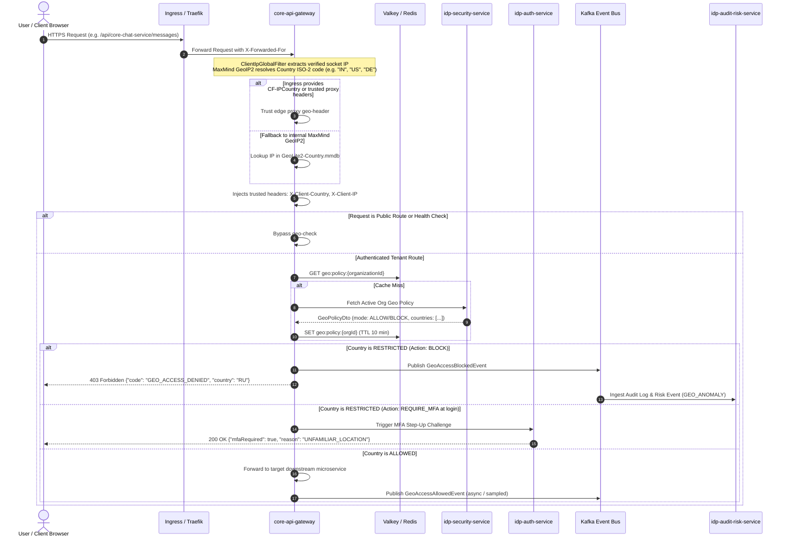
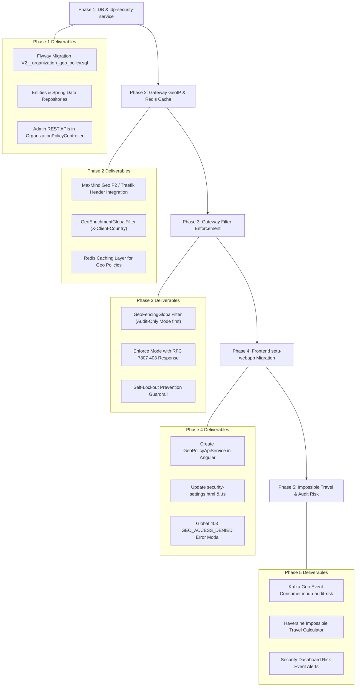

# Enterprise Architecture Blueprint: End-to-End Geo-Fencing & Conditional Access

## 1. Executive Summary & Industry Architecture Benchmark

This document defines the production-grade, end-to-end enterprise architecture for **Geo-Fencing and Location-Based Conditional Access** across the Setu platform.

Currently, the frontend (`setu-webapp`) contains a UI prototype in `security-settings.html` and `security-preferences.service.ts` that saves country allow/deny rules strictly in browser `localStorage` with the notice:
> *"Saved in this browser only"*

This design is insufficient for enterprise environments:
1. Client-side storage cannot enforce access controls; requests can easily be forged via curl, mobile apps, or headless clients.
2. Browser-reported coordinates (HTML5 Geolocation API) or third-party client lookups (e.g. `ipwho.is`) can be faked, blocked, or altered with browser extensions.
3. No enforcement exists at the API gateway layer or identity layer.

### Enterprise Benchmark Comparison

| Architectural Pillar | Microsoft Entra ID (Named Locations) | Okta Identity Cloud (Dynamic Zones) | Google BeyondCorp Enterprise | **Setu Enterprise Architecture (Target)** |
|---|---|---|---|---|
| **Enforcement Point** | Cloud Edge & STS token evaluation | API Gateway & Sign-On Policies | Google Front End (GFE) & IAM Envoy | **`core-api-gateway` (WebFlux Edge) & `idp-security-service`** |
| **IP / Geo Resolution** | Edge reverse-proxy socket + MaxMind/MS IP Intelligence | MaxMind GeoIP Enterprise + Akamai Edge | Cloud Armor + Internal IP Mapping | **`ClientIpGlobalFilter` + MaxMind GeoIP2 / Traefik Ingress headers** |
| **Policy Scope** | Tenant-wide & Per-Group Conditional Access | Tenant Network Zone + App Sign-on Policy | Context-Aware Access Levels | **Multi-Tenant Organization Security Policy (`organizationId`)** |
| **Enforcement Modes** | `Block` or `Require MFA` (Step-Up) | `Prompt Factor` or `Deny Access` | `Deny Access` | **`BLOCK` (403 Forbidden) or `REQUIRE_MFA` (Step-Up Challenge)** |
| **Risk Heuristics** | Impossible Travel (Atypical travel speed) | Anomalous Location & Velocity Check | Device & Location Risk Engine | **`idp-audit-risk-service` (Haversine velocity > 900 km/h)** |
| **Storage & Caching** | Distributed Directory + Edge Cache | Redis Cluster Dynamic Zone Cache | Spanner + Edge Cache | **PostgreSQL (Flyway) + Valkey/Redis sub-millisecond cache** |

---

## 2. End-to-End System Architecture



---

## 3. Backend Architecture & Changes Required

### A. `core-api-gateway` (The Enforcement Boundary)

The API Gateway is the single point of entry for all API traffic (`https://api.setu.domain.com`). It must evaluate policies with sub-millisecond latency before routing requests to microservices.

#### 1. GeoIP Lookup Provider
- Integrate MaxMind `GeoIP2-Country` (or `GeoIP2-City`) via the official Java SDK:
  ```xml
  <dependency>
      <groupId>com.maxmind.geoip2</groupId>
      <artifactId>geoip2</artifactId>
      <version>4.2.0</version>
  </dependency>
  ```
- Load `GeoLite2-Country.mmdb` into off-heap memory using `DatabaseReader` with `CHACHE_TYPE.MEMORY`.
- Support periodic background reload of the `.mmdb` database without restarting the gateway container.
- Edge proxy fallback:
  ```java
  String country = request.getHeaders().getFirst("CF-IPCountry"); // Cloudflare
  if (country == null || country.isBlank() || "XX".equalsIgnoreCase(country)) {
      country = geoIpService.resolveCountryIso(clientIp);
  }
  ```

#### 2. Header Enrichment (`GeoEnrichmentGlobalFilter`)
Run immediately after `ClientIpGlobalFilter` (Order: `Ordered.HIGHEST_PRECEDENCE + 15`):
- Strip any incoming client-supplied `X-Client-Country`, `X-Client-City`, `X-Client-Latitude`, `X-Client-Longitude`.
- Inject verified server-computed headers:
  - `X-Client-Country`: e.g. `IN`, `US`, `GB`.
  - `X-Client-IP`: (already set by `ClientIpGlobalFilter`).

#### 3. Gateway Enforcement Filter (`GeoFencingGlobalFilter`)
- Runs after `JwtAuthFilter` and `BffSessionRelayFilter` (where `organizationId` and `userId` are established):
- Look up policy in Valkey/Redis:
  - Key: `geo:policy:{organizationId}`
  - Structure: JSON or Hash containing `{ "enabled": true, "mode": "ALLOW_LIST", "countries": ["IN","US"], "action": "BLOCK", "bypassAdmin": true }`.
- Evaluation rules:
  1. If `enabled == false`: Allow immediately.
  2. If client IP is within RFC 1918 private ranges (`10.0.0.0/8`, `172.16.0.0/12`, `192.168.0.0/16`, `127.0.0.1`): Allow or resolve to Org headquarters default country.
  3. If caller has `ROLE_SUPER_ADMIN` or emergency break-glass claim and `bypassAdmin == true`: Allow.
  4. If `mode == "ALLOW_LIST"` and `country` is NOT in `countries`: Trigger Action (`BLOCK` $\rightarrow$ 403 Forbidden).
  5. If `mode == "BLOCK_LIST"` and `country` IS in `countries`: Trigger Action (`BLOCK` $\rightarrow$ 403 Forbidden).
- Standard Error Response Payload (RFC 7807):
  ```json
  {
    "type": "https://errors.setu.domain.com/geo-access-denied",
    "title": "Access Restricted By Geographic Policy",
    "status": 403,
    "code": "GEO_ACCESS_DENIED",
    "detail": "Connections originating from country 'CN' are restricted by organization security policy.",
    "clientIp": "198.51.100.42",
    "detectedCountry": "CN",
    "organizationId": "a90f1d2e-3c4b-5a6f-7e8d-9c0b1a2d3e4f",
    "timestamp": "2026-11-10T12:00:00Z",
    "traceId": "req-98f21b-440a"
  }
  ```

---

### B. `idp-security-service` (Policy Authoring & Management Domain)

`idp-security-service` owns tenant security policies (already managing MFA requirements, trusted devices, and lockout duration). Geo-fencing is a direct extension of `organization_security_policies`.

#### 1. Database Schema Migration (`V2__organization_geo_policy.sql`)
```sql
-- 1. Create enum for geo policy modes and actions
DO $$ BEGIN
    IF NOT EXISTS (SELECT 1 FROM pg_type WHERE typname = 'geo_policy_mode') THEN
        CREATE TYPE geo_policy_mode AS ENUM ('ALLOW_LIST', 'BLOCK_LIST');
    END IF;
    IF NOT EXISTS (SELECT 1 FROM pg_type WHERE typname = 'geo_policy_action') THEN
        CREATE TYPE geo_policy_action AS ENUM ('BLOCK', 'REQUIRE_MFA');
    END IF;
END $$;

-- 2. Organization Geo-Fencing Policy Table
CREATE TABLE IF NOT EXISTS organization_geo_policies (
    organization_id UUID PRIMARY KEY,
    enabled BOOLEAN NOT NULL DEFAULT FALSE,
    mode geo_policy_mode NOT NULL DEFAULT 'ALLOW_LIST',
    action geo_policy_action NOT NULL DEFAULT 'BLOCK',
    allow_internal_ips BOOLEAN NOT NULL DEFAULT TRUE,
    bypass_admin_emergency BOOLEAN NOT NULL DEFAULT TRUE,
    created_at TIMESTAMPTZ NOT NULL DEFAULT NOW(),
    created_by UUID,
    modified_at TIMESTAMPTZ NOT NULL DEFAULT NOW(),
    modified_by UUID,
    CONSTRAINT fk_org_geo_policy_org FOREIGN KEY (organization_id) 
        REFERENCES organizations(id) ON DELETE CASCADE
);

-- 3. Allowed / Blocked ISO Country Codes (normalized 1:N table)
CREATE TABLE IF NOT EXISTS organization_geo_countries (
    organization_id UUID NOT NULL,
    country_code VARCHAR(2) NOT NULL, -- ISO 3166-1 alpha-2, e.g. "IN", "US", "DE"
    country_name VARCHAR(100) NOT NULL,
    created_at TIMESTAMPTZ NOT NULL DEFAULT NOW(),
    created_by UUID,
    PRIMARY KEY (organization_id, country_code),
    CONSTRAINT fk_geo_countries_policy FOREIGN KEY (organization_id) 
        REFERENCES organization_geo_policies(organization_id) ON DELETE CASCADE
);

CREATE INDEX idx_geo_countries_lookup ON organization_geo_countries(organization_id, country_code);
```

#### 2. Domain Entity & Repository
- `OrganizationGeoPolicy.java`: JPA Entity with `@OneToMany` mapping to `OrganizationGeoCountry`.
- `OrganizationGeoPolicyRepository.java`: Spring Data JPA repository.
- `GeoPolicyCachePublisher.java`: Invalidate / update Redis cache (`geo:policy:{orgId}`) upon any policy write.

#### 3. Admin REST API Specification
- `GET /api/idp-security-service/organizations/{orgId}/geo-policy`
  - Requires permission: `security.policy.read` (Org Admin or Security Admin).
  - Returns current geo-policy and configured country list.
- `PUT /api/idp-security-service/organizations/{orgId}/geo-policy`
  - Requires permission: `security.policy.manage` (Org Admin only).
  - Request Body:
    ```json
    {
      "enabled": true,
      "mode": "ALLOW_LIST",
      "action": "BLOCK",
      "allowInternalIps": true,
      "bypassAdminEmergency": true,
      "countries": ["IN", "US", "GB", "DE"]
    }
    ```
  - **Safety Check:** If the current calling admin's IP is outside the submitted `ALLOW_LIST`, return `400 Bad Request` (`CANNOT_LOCKOUT_SELF`) unless explicit override flag is passed.
- `POST /api/idp-security-service/organizations/{orgId}/geo-policy/test-ip`
  - Allows security admins to test an arbitrary IP (e.g. `203.0.113.19`) to preview how the policy resolves (Resolved Country, Action, Allowed/Blocked status).

---

### C. `idp-auth-service` (Authentication & Step-Up MFA Challenge)

When an organization policy specifies `action: REQUIRE_MFA`:
1. During password authentication at `/api/idp-auth-service/login`:
   - Inspect `X-Client-Country` provided by `core-api-gateway`.
   - Query user's organization geo-policy.
   - If user is logging in from an untrusted country, do not issue standard JWT tokens immediately.
   - Instead, trigger step-up MFA challenge: return `200 OK` with `mfaRequired: true`, `mfaSessionId: "..."`, `reason: "GEO_LOCATION_STEPUP"`.
2. Once the user completes TOTP / Passkey verification, issue tokens containing a risk level claim: `risk_loc: "VERIFIED_STEPUP"`.

---

### D. `idp-audit-risk-service` (Risk Scoring & Impossible Travel Detection)

`idp-audit-risk-service` already defines `RiskEventEnum.GEO_ANOMALY` and `RiskEventEnum.IMPOSSIBLE_TRAVEL`.

#### 1. Impossible Travel Heuristic Engine
When user `U` successfully logs in from Country A $(lat_1, lon_1)$ at timestamp $t_1$, and later logs in from Country B $(lat_2, lon_2)$ at timestamp $t_2$:
1. Calculate distance $D$ using the Great-Circle Haversine Formula:
   $$d = 2R \cdot \arcsin\left(\sqrt{\sin^2\left(\frac{\Delta \phi}{2}\right) + \cos(\phi_1)\cos(\phi_2)\sin^2\left(\frac{\Delta \lambda}{2}\right)}\right)$$
2. Compute required ground speed:
   $$v = \frac{D}{t_2 - t_1}$$
3. If $v > 900 \text{ km/h}$ (standard commercial airliner speed with airport buffer):
   - Record `RiskEventEntity` with type `IMPOSSIBLE_TRAVEL`, severity `HIGH`.
   - Ingest into `audit_logs` table (`AuditActionEnum.AUTH_CHALLENGE`).
   - Trigger optional automated session revocation via `BffRevocationBus`.

---

## 4. Frontend Architecture & Changes Required (`setu-webapp`)

### A. Service Layer Refactor: Deprecate `localStorage` Mock

In `setu-webapp/src/app/features/settings/security-settings/`:
- **Current State:** `security-preferences.service.ts` saves to `localStorage` under `setu_security_prefs` with mock state `geo: { enabled: false, mode: 'allow', countries: [] }`.
- **Target State:**
  1. Create a dedicated `GeoPolicyApiService` in `src/app/core/services/geo-policy-api.service.ts`:
     - `getGeoPolicy(orgId: string): Observable<OrganizationGeoPolicyDto>`
     - `updateGeoPolicy(orgId: string, policy: UpdateGeoPolicyRequest): Observable<OrganizationGeoPolicyDto>`
     - `testIpResolution(orgId: string, ip: string): Observable<IpResolutionResult>`
  2. Update `SecurityPreferencesService` or inject `GeoPolicyApiService` directly into `SecuritySettingsComponent`.
  3. Load the true backend policy on component initialization:
     ```ts
     ngOnInit(): void {
       this.geoPolicyService.getGeoPolicy(this.orgId).subscribe({
         next: (policy) => {
           this.geoEnabled.set(policy.enabled);
           this.geoMode.set(policy.mode);
           this.selectedCountries.set(policy.countries);
         },
         error: (err) => this.showErrorToast('Failed to load security policy')
       });
     }
     ```

### B. UI/UX Enhancements in `security-settings.html`

1. **Remove Browser-Only Disclaimer:**
   - Remove: `<p class="notice">{{ 'settings.securitySettings.savedInThisBrowserOnly' | transloco }}</p>`
   - Replace with Cloud Sync Badge: `<span class="chip chip-success"><app-icon name="cloud-check" [size]="14" /> Enforced by Organization Gateway</span>`.

2. **Caller Context & Detected Location Banner:**
   - Show admin's own detected IP and country:
     > *"Your current connection: **India (IN)** • IP: `49.37.12.84` (Allowed)"*
   - Display a warning if the admin attempts to save an `ALLOW_LIST` that does not include their current country.

3. **Action Mode Switcher:**
   - Allow admins to choose between:
     - **Hard Block:** Terminate connection with 403 Forbidden.
     - **Step-Up Authentication:** Force Multi-Factor Authentication if logging in from outside approved countries.

4. **Role-Based Access Control (RBAC):**
   - If user is not an Organization Admin, render the Geo-Fencing section in read-only / informational mode:
     > *"Geographic access policies are centrally managed by your Organization Administrator."*

### C. Global Access Denied Error Boundary

When any HTTP request in `setu-webapp` receives a 403 with `GEO_ACCESS_DENIED`:
1. The global HTTP error interceptor (`error.interceptor.ts`) intercepts the response.
2. Rather than a generic error toast, route the user to `/access-restricted` or display a modal:
   - Header: **"Access Restricted by Organization Security Policy"**
   - Explanation: *"Your organization restricts access to Setu from your current geographic region ([Detected Country])."*
   - Metadata: Shows Client IP, Organization Name, Trace ID, and an "Email Administrator" button.

---

## 5. Database Schema & Data Contracts

### A. Data Transfer Objects (DTOs)

#### 1. GeoPolicyDto
```json
{
  "organizationId": "3fa85f64-5717-4562-b3fc-2c963f66afa6",
  "enabled": true,
  "mode": "ALLOW_LIST",
  "action": "BLOCK",
  "allowInternalIps": true,
  "bypassAdminEmergency": true,
  "countries": [
    { "code": "IN", "name": "India" },
    { "code": "US", "name": "United States" },
    { "code": "DE", "name": "Germany" }
  ],
  "modifiedAt": "2026-11-10T12:00:00Z",
  "modifiedBy": "7b8e1f20-9412-4e89-b001-a1b2c3d4e5f6"
}
```

#### 2. UpdateGeoPolicyRequest
```json
{
  "enabled": true,
  "mode": "ALLOW_LIST",
  "action": "BLOCK",
  "allowInternalIps": true,
  "bypassAdminEmergency": true,
  "countryCodes": ["IN", "US", "DE"]
}
```

### B. Redis Key Format & Cache Strategy

- **Key:** `geo:policy:{organizationId}`
- **TTL:** 600 seconds (10 minutes) with write-through invalidation.
- **Cache Format:**
  ```json
  {
    "enabled": true,
    "mode": "ALLOW",
    "action": "BLOCK",
    "allowInternal": true,
    "countries": ["IN", "US", "DE"]
  }
  ```
- **Cache Invalidation:**
  - Whenever `PUT /api/idp-security-service/organizations/{orgId}/geo-policy` is called:
    1. Update PostgreSQL database within transaction.
    2. Overwrite / Evict Redis key `geo:policy:{orgId}`.
    3. Publish message on Redis Pub/Sub channel `geo-policy-invalidation` so all distributed Gateway pods refresh local L1 in-memory caches.

---

## 6. Edge Cases, Security Hardening & Break-Glass Safeguards

1. **Admin Self-Lockout Prevention:**
   - If an admin is currently connecting from IP `203.0.113.50` (resolved to `US`), and configures `ALLOW_LIST` containing only `["IN"]`:
   - The API will reject the change with HTTP 422:
     ```json
     {
       "code": "ADMIN_LOCKOUT_PREVENTED",
       "message": "Cannot save policy: Your current country ('US') is not included in the allow list. Add 'US' or check bypass emergency admin."
     }
     ```
2. **Break-Glass Emergency Access:**
   - Dedicated break-glass admin accounts (flagged in `idp-user-service` with `is_emergency_admin = true`) bypass the gateway geo-filter when authenticating with hardware FIDO2 passkeys.
3. **Private & Corporate VPN Ranges:**
   - Private RFC 1918 addresses (`10.0.0.0/8`, `172.16.0.0/12`, `192.168.0.0/16`) and loopback (`127.0.0.1`, `::1`) bypass geo-resolution and default to `ALLOW` when `allowInternalIps: true`.
4. **GeoIP Database Automated Updates:**
   - MaxMind releases weekly updates for GeoLite2. A Kubernetes CronJob or scheduled task runs weekly to download the latest `.mmdb`, verify SHA256 checksums, and trigger a hot reload in `core-api-gateway`.

---

## 7. Phased Implementation Roadmap



---

## 8. File Modification Matrix

| Component | File Path | Nature of Change |
|---|---|---|
| **`idp-security-service`** | `src/main/resources/db/migration/V2__organization_geo_policy.sql` | **New File:** Flyway migration for geo policies & country tables |
| **`idp-security-service`** | `src/main/java/.../entity/OrganizationGeoPolicy.java` | **New File:** JPA entity for organization geo policy |
| **`idp-security-service`** | `src/main/java/.../entity/OrganizationGeoCountry.java` | **New File:** JPA entity for allowed/denied ISO-2 countries |
| **`idp-security-service`** | `src/main/java/.../repository/OrganizationGeoPolicyRepository.java` | **New File:** Spring Data JPA repository |
| **`idp-security-service`** | `src/main/java/.../controller/OrganizationPolicyController.java` | **Update:** Add endpoints `GET/PUT /organizations/{orgId}/geo-policy` |
| **`idp-security-service`** | `src/main/java/.../service/OrganizationGeoPolicyService.java` | **New File:** Service logic with Redis invalidation |
| **`core-api-gateway`** | `pom.xml` | **Update:** Add MaxMind GeoIP2 dependency |
| **`core-api-gateway`** | `src/main/java/.../security/GeoIpService.java` | **New File:** MaxMind MMDB reader and ISO country resolver |
| **`core-api-gateway`** | `src/main/java/.../security/GeoEnrichmentGlobalFilter.java` | **New File:** Injects `X-Client-Country` header |
| **`core-api-gateway`** | `src/main/java/.../security/GeoFencingGlobalFilter.java` | **New File:** Evaluates tenant policy from Redis and blocks if restricted |
| **`idp-audit-risk-service`**| `src/main/java/.../service/ImpossibleTravelService.java` | **New File:** Haversine velocity calculator for login events |
| **`setu-webapp`** | `src/app/core/services/geo-policy-api.service.ts` | **New File:** Real backend REST client for geo policy |
| **`setu-webapp`** | `src/app/features/settings/security-settings/security-preferences.service.ts` | **Update:** Remove localStorage mock; delegate to `GeoPolicyApiService` |
| **`setu-webapp`** | `src/app/features/settings/security-settings/security-settings.html` | **Update:** Remove "Saved in this browser only", add cloud status & current location |
| **`setu-webapp`** | `src/app/features/settings/security-settings/security-settings.ts` | **Update:** Handle loading, saving, and lockout guardrails |
| **`setu-webapp`** | `src/app/core/interceptors/error.interceptor.ts` | **Update:** Handle `GEO_ACCESS_DENIED` 403 error code with user modal |
