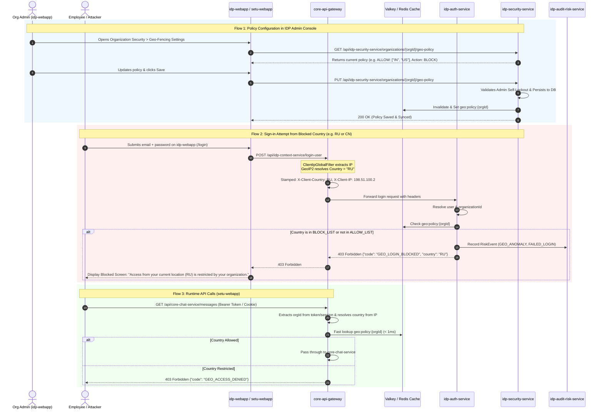

# Enterprise Blueprint: IDP Organization Geo-Fencing & Conditional Access

## 1. Executive Validation & Architectural Confirmation

You are **100% correct**. 

In modern enterprise identity architectures (such as Okta, Microsoft Entra ID, and Google Cloud Identity), **Geo-Fencing is fundamentally an Organization-level security policy managed centrally in the Identity Provider Portal (`idp-webapp`) and stored in the Identity Security Service (`idp-security-service`).**

### Why this is the correct standard:
1. **Central Governance:** An organization administrator (IT / CISO) configures company-wide security rules (MFA, password expiration, trusted devices, and Geo-fencing) in one place: the IDP console (`idp-webapp`).
2. **Pre-Authentication Front Door Defense:** If an attacker in a restricted country attempts to log into an employee account, the login is blocked **at the front door** before tokens or sessions are ever issued.
3. **Runtime Protection at the Edge Gateway (`core-api-gateway`):** If an employee's session token is stolen or if an active session suddenly switches to a blocked country (e.g., untrusted VPN or exit node), the API Gateway intercepts and rejects the request immediately using a sub-millisecond Redis cache.
4. **Clean Decoupling:** Downstream applications (like `setu-webapp` for chat/VoIP, or `core-mail-service`) do not manage security policies; they simply display the organization's enforced status and trust the gateway and identity provider.

---

## 2. End-to-End System Flow Diagram



---

## 3. `idp-webapp` UI & Administration Experience

In `idp-webapp`, Org Admins already manage Organization Details, Apps, and Governance Security. Geo-Fencing is introduced as a first-class card under **Organization Security Controls**.

### A. Location in `idp-webapp` Navigation
- Route: `/organization-details/security` or `/governance-security`
- Accessible only to users holding `@idpRoles.orgAdmin` or `SUPER_ADMIN`.

### B. Admin UI Controls
```
+------------------------------------------------------------------------------------+
|  [icon: globe]  Geographic Access & Conditional Locations                          |
|  Control which countries your employees can sign in and access company data from.  |
|                                                                    [ Switch: ON ]  |
+------------------------------------------------------------------------------------+
|                                                                                    |
|  Policy Enforcement Mode:                                                          |
|  (o) ALLOW LIST: Only permit connections from selected countries (Recommended)     |
|  ( ) BLOCK LIST: Block connections from selected high-risk countries               |
|                                                                                    |
|  Enforcement Action when outside permitted countries:                              |
|  (o) Hard Block: Deny sign-in and API access completely with a security notice     |
|  ( ) Require Step-Up MFA: Allow sign-in only if user passes hardware MFA / Passkey |
|                                                                                    |
|  Selected Countries (2 added):                                                     |
|  [ Flag: IN ] India            (HQ)       [x]                                      |
|  [ Flag: US ] United States    (Branch)   [x]                                      |
|                                                                                    |
|  [ + Add Country Dropdown... ] [ Add ]                                             |
|                                                                                    |
|  [x] Allow internal corporate private networks (10.0.0.0/8, 192.168.0.0/16)       |
|  [x] Emergency Break-Glass: Allow verified emergency admins to bypass              |
|                                                                                    |
|  --------------------------------------------------------------------------------  |
|  [!] Your Current Connection: India (IN) * IP: 49.37.12.84                         |
|      (Your current location is covered by this policy. You will not be locked out) |
|                                                                                    |
|  [ Save Security Policy ]                                                          |
+------------------------------------------------------------------------------------+
```

### C. Self-Lockout Prevention Guardrail (Critical UX Requirement)
If an admin in India accidentally configures `ALLOW LIST: ["US"]` without including India:
- The UI triggers an immediate warning dialog:
  > **"Caution: Potential Admin Lockout"**  
  > *"Your current connection originates from India (IN). Saving this policy will immediately terminate your session and block your access. Are you sure you wish to proceed?"*
- Requires explicit admin confirmation before sending the `PUT` request.

---

## 4. Backend Architecture & Changes Required

### A. `idp-security-service` (The Policy Storage & Authority)

`idp-security-service` already manages `OrganizationSecurityPolicy` (`mfaRequired`, `allowedMfaMethods`, `maxFailedAttempts`, `lockoutDurationMinutes`). We enhance this domain with Geo-Fencing.

#### 1. Database Schema (`V2__organization_geo_policy.sql`)
```sql
-- 1. Create Enums
DO $$ BEGIN
    IF NOT EXISTS (SELECT 1 FROM pg_type WHERE typname = 'geo_policy_mode') THEN
        CREATE TYPE geo_policy_mode AS ENUM ('ALLOW_LIST', 'BLOCK_LIST');
    END IF;
    IF NOT EXISTS (SELECT 1 FROM pg_type WHERE typname = 'geo_policy_action') THEN
        CREATE TYPE geo_policy_action AS ENUM ('BLOCK', 'REQUIRE_MFA');
    END IF;
END $$;

-- 2. Organization Geo Policies Table
CREATE TABLE IF NOT EXISTS organization_geo_policies (
    organization_id UUID PRIMARY KEY,
    enabled BOOLEAN NOT NULL DEFAULT FALSE,
    mode geo_policy_mode NOT NULL DEFAULT 'ALLOW_LIST',
    action geo_policy_action NOT NULL DEFAULT 'BLOCK',
    allow_internal_ips BOOLEAN NOT NULL DEFAULT TRUE,
    bypass_admin_emergency BOOLEAN NOT NULL DEFAULT TRUE,
    created_at TIMESTAMPTZ NOT NULL DEFAULT NOW(),
    created_by UUID,
    modified_at TIMESTAMPTZ NOT NULL DEFAULT NOW(),
    modified_by UUID,
    CONSTRAINT fk_geo_org FOREIGN KEY (organization_id) REFERENCES organizations(id) ON DELETE CASCADE
);

-- 3. Normalized Countries Table
CREATE TABLE IF NOT EXISTS organization_geo_countries (
    organization_id UUID NOT NULL,
    country_code VARCHAR(2) NOT NULL, -- ISO 3166-1 alpha-2, e.g. "IN", "US"
    country_name VARCHAR(100) NOT NULL,
    created_at TIMESTAMPTZ NOT NULL DEFAULT NOW(),
    created_by UUID,
    PRIMARY KEY (organization_id, country_code),
    CONSTRAINT fk_geo_country_org FOREIGN KEY (organization_id) REFERENCES organization_geo_policies(organization_id) ON DELETE CASCADE
);

CREATE INDEX idx_geo_countries ON organization_geo_countries (organization_id, country_code);
```

#### 2. REST Endpoints in `OrganizationPolicyController.java`
- `GET /api/idp-security-service/organizations/{orgId}/geo-policy`
  - Fetches the active geo-policy and country list for the caller's organization.
- `PUT /api/idp-security-service/organizations/{orgId}/geo-policy`
  - Saves the policy and writes to Valkey/Redis cache (`geo:policy:{orgId}`).
- `POST /api/idp-security-service/internal/geo-policy/evaluate`
  - Internal fast-evaluation endpoint called by `idp-auth-service` and `core-api-gateway`.

---

### B. Login-Time Enforcement (`idp-auth-service` & `idp-context-service`)

When an employee or attacker attempts to sign in via `loginUser` (`POST /api/idp-context-service/login-user`):

#### Step-by-Step Execution:
1. **IP & Geo Detection:**
   `core-api-gateway` reads socket IP via `ClientIpGlobalFilter`, looks up MaxMind GeoIP2, and sets:
   - `X-Client-IP`: `198.51.100.42`
   - `X-Client-Country`: `RU`
2. **User & Tenant Lookup:**
   The auth backend resolves the user's account from their email or username. From the user account, it identifies their `organizationId`.
3. **Geo-Policy Evaluation:**
   Before checking passwords or validating credentials, the auth backend evaluates the organization's geo-policy:
   - Queries Redis cache `geo:policy:{orgId}` (with fallback to `idp-security-service`).
   - If policy `enabled == true`:
     - If client IP is private/internal and `allowInternalIps == true` $\rightarrow$ **ALLOW**.
     - If user has emergency break-glass status and `bypassAdminEmergency == true` $\rightarrow$ **ALLOW**.
     - If `mode == "ALLOW_LIST"` and `X-Client-Country` is NOT in allowed countries:
       - **Action = BLOCK:** Stop authentication immediately.
         Emit Kafka security event (`GEO_ANOMALY`, `FAILED_LOGIN`).
         Return HTTP 403:
         ```json
         {
           "code": "GEO_LOGIN_BLOCKED",
           "message": "Sign-in from country 'RU' is not permitted by your organization.",
           "detectedCountry": "RU",
           "organizationName": "Acme Corp"
         }
         ```
       - **Action = REQUIRE_MFA:** 
         Validate password. If correct, instead of returning JWT tokens, return a step-up challenge:
         ```json
         {
           "mfaRequired": true,
           "mfaSessionId": "stepup-9f201a",
           "challengeReason": "UNFAMILIAR_LOCATION",
           "message": "Connecting from a new location. Please verify with your authenticator app or passkey."
         }
         ```
     - If `mode == "BLOCK_LIST"` and `X-Client-Country` IS in blocked countries $\rightarrow$ Trigger the configured action.
4. **Allowed Country:**
   Normal authentication proceeds. The `login_history` record is saved with `ip_address` and `country: "IN"`.

---

### C. Runtime API Enforcement (`core-api-gateway`)

Why is login enforcement alone not enough?
- An attacker could steal an active session cookie or JWT token (via XSS or malware) and use it from a restricted country.
- An employee could log in from India, then connect to a VPN exit node in a sanctioned country.

#### Gateway Filter (`GeoFencingGlobalFilter.java`):
1. Runs on every authenticated route (`/api/**`).
2. Extracts `organizationId` from the caller's JWT token or BFF session.
3. Reads `X-Client-Country` (stamped by `GeoEnrichmentGlobalFilter`).
4. Performs an in-memory/Redis check against `geo:policy:{orgId}`:
   - Latency overhead: **< 0.5 milliseconds**.
5. If restricted:
   - Instantly terminates request with `403 Forbidden` (`{"code": "GEO_ACCESS_DENIED"}`).
   - Downstream services (`core-chat-service`, `core-mail-service`) never even see the packet.

---

### D. Audit, Intelligence & Anomaly Scoring (`idp-audit-risk-service`)

`idp-audit-risk-service` already defines `GEO_ANOMALY` and `IMPOSSIBLE_TRAVEL` in `RiskEventEnum`.

1. **Audit Ingestion:**
   Whenever a geo-fencing block occurs, `core-api-gateway` or `idp-auth-service` publishes a Kafka event:
   ```json
   {
     "eventType": "GEO_ANOMALY",
     "userId": "uuid-here",
     "organizationId": "org-uuid-here",
     "ipAddress": "198.51.100.42",
     "detectedCountry": "RU",
     "actionTaken": "BLOCKED",
     "timestamp": "2026-11-10T13:00:00Z"
   }
   ```
2. **Impossible Travel Detection:**
   If User A signs in from India at 12:00 PM, and from Germany at 12:45 PM:
   - Distance: ~6,000 km in 45 minutes $\rightarrow$ velocity ~8,000 km/h (impossible).
   - Generates high-severity `IMPOSSIBLE_TRAVEL` risk alert.
   - Automatically revokes active sessions via `BffRevocationBus`.

---

## 5. User-Facing Behavior in `setu-webapp`

In the end-user application (`setu-webapp`):

1. **Personal Security Settings (`security-settings.html`):**
   - The old mock saying *"Saved in this browser only"* is removed.
   - It is replaced by an **Organization Enforced Policy Badge**:
     ```html
     <div class="org-policy-card">
       <app-icon name="shield-check" [size]="20" />
       <div>
         <h4>Organization Geographic Access</h4>
         <p>Centrally managed by your organization administrator.</p>
         <span class="chip chip-success">Protected: Active Policy</span>
       </div>
       @if (isOrgAdmin()) {
         <a href="/idp/organization-details/security" class="btn btn-outline">
           Manage in IDP Console
         </a>
       }
     </div>
     ```
2. **Global 403 Error Handler:**
   - If an active employee gets blocked (e.g. turning on an unauthorized VPN), `setu-webapp` intercepts `GEO_ACCESS_DENIED` and displays a clean modal:
     > **Access Restricted**  
     > *Your connection from Russia (RU) is restricted by Acme Corp's security policy.*  
     > *Request ID: `req-8491` • IP: `198.51.100.42`*

---

## 6. Implementation Checklist & Phased Rollout

| Phase | Target Service / App | Tasks to Execute |
|---|---|---|
| **Phase 1** | **`idp-security-service`** | 1. Add Flyway migration `V2__organization_geo_policy.sql`.<br/>2. Create `OrganizationGeoPolicy` entity and repository.<br/>3. Implement `GET`/`PUT /organizations/{orgId}/geo-policy` endpoints.<br/>4. Implement Redis write-through cache and invalidation. |
| **Phase 2** | **`idp-webapp`** | 1. Create `GeoPolicyService` calling `idp-security-service`.<br/>2. Add Geo-Fencing configuration card in Organization Security page.<br/>3. Implement self-lockout warning and country search dropdown. |
| **Phase 3** | **`idp-auth-service` / Context** | 1. Add Geo-policy check in login flow (`login-user`).<br/>2. Handle `BLOCK` (return 403 with `GEO_LOGIN_BLOCKED`) and `REQUIRE_MFA`.<br/>3. Display user-friendly block screen on `idp-webapp` login page. |
| **Phase 4** | **`core-api-gateway`** | 1. Integrate MaxMind GeoIP2 dependency.<br/>2. Create `GeoEnrichmentGlobalFilter` to set `X-Client-Country`.<br/>3. Create `GeoFencingGlobalFilter` to validate Redis cached policy on active API calls. |
| **Phase 5** | **`setu-webapp`** | 1. Replace `localStorage` mock in `security-preferences.service.ts` with Org status.<br/>2. Add `GEO_ACCESS_DENIED` interceptor modal. |
