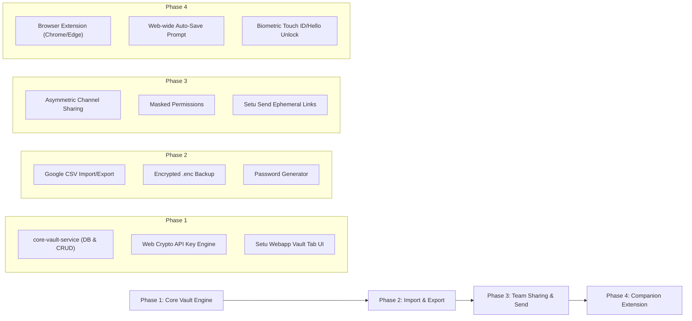

# Strategic Product & Architecture Blueprint: Setu Enterprise Zero-Knowledge Password Vault

## 1. Executive Purpose: What Is This & Why Is It Needed?

### What Is It?
The **Setu Enterprise Zero-Knowledge Password Vault** is a secure, end-to-end encrypted credential management system built natively into the Setu and IDP ecosystem. It enables individual employees and entire corporate teams to:
- Store, generate, and auto-fill web logins, API keys, secure notes, and credit cards.
- Seamlessly import and export backups to and from **Google Password Manager, Bitwarden, 1Password, and Apple Keychain**.
- Share sensitive corporate logins (e.g. shared social media accounts, cloud consoles, server logins) across teams and channels with **zero leaks**, strict access permissions, and self-destructing secure links.
- Prompt users with an intuitive **"Save to Setu Vault?"** banner whenever they log into a new tool, identical to Google Chrome and 1Password.

---

### For What Purpose Is This Needed? (The Core Enterprise Problems It Solves)

In modern organizations, credential handling without a native vault leads to severe security risks and organizational chaos:

```
┌───────────────────────────────────────────────┐
│        THE REALITY OF TEAMS TODAY            │
├───────────────────────────────────────────────┤
│ ❌ Passwords shared in Slack/Teams/WhatsApp   │
│ ❌ Passwords written on spreadsheets & notes  │
│ ❌ Employees reuse the same weak password     │
│ ❌ When an employee leaves, passwords remain  │
│    in their personal Google Password Manager  │
│ ❌ Phishing attacks trick users into fake sites│
└───────────────────────────────────────────────┘
                       │
                       ▼
┌───────────────────────────────────────────────┐
│     HOW SETU ENTERPRISE VAULT FIXES IT        │
├───────────────────────────────────────────────┤
│ ✅ Zero-Knowledge Encryption: No server leaks │
│ ✅ 1-Click Role-Based Team & Channel Sharing │
│ ✅ Masked Passwords: Use without seeing raw   │
│ ✅ Instant Revocation when employees depart   │
│ ✅ Biometric / Passkey instant unlock         │
│ ✅ Seamless 2-Way Backup with Google/Apple    │
└───────────────────────────────────────────────┘
```

1. **Eliminates Plaintext Credential Leaks in Chat:**
   Teams constantly share shared accounts (e.g., Marketing Twitter/X, Stripe, AWS staging, Zoom licenses) by pasting passwords into plain chat messages. If a chat account is compromised or an employee leaves, those passwords are exposed forever.
2. **Stops Employee Credential Theft on Departure:**
   When an employee leaves an organization, passwords stored in their personal Google Password Manager stay on their personal laptop. With an organization vault, team credentials can be instantly revoked with one click.
3. **Solves the "Shadow IT" Subscription Cost:**
   Companies spend **$8 to $12 per employee per month** subscribing to third-party tools like 1Password or Dashlane. Integrating this directly into Setu saves substantial enterprise budget while offering a unified identity and chat experience.

---

### Is This Really Used by Other Applications, or Is It Overkill?

| Platform | Has Built-in Vault / Credential Manager? | How They Use It | Is It Overkill? |
|---|---|---|---|
| **Apple (macOS / iOS / Safari)** | **Yes (Apple Passwords / iCloud Keychain)** | Native OS and browser integration; auto-generates, shares across family/work groups, exports CSV. | **No, essential.** Drove massive user retention and eliminated weak passwords. |
| **Google (Chrome / Android / Workspace)** | **Yes (Google Password Manager)** | Built into Chrome, Android, and Google Accounts; auto-saves, auto-fills, alerts on data breaches. | **No, foundational.** Used by over 2 billion people daily. |
| **Bitwarden / 1Password** | **Yes (Dedicated Enterprise Vaults)** | Gold-standard enterprise security; team sharing, collections, command-line CLI, browser extensions. | **Standard of the industry.** Standard requirement for SOC 2, ISO 27001, and HIPAA compliance. |
| **Proton (Proton Mail / Drive / Pass)** | **Yes (Proton Pass)** | Bundled end-to-end encrypted password manager inside their secure email & storage ecosystem. | **A major competitive advantage.** Accelerated user adoption from corporate clients. |
| **Okta Identity Cloud** | **Yes (Okta Privileged Access & Secure Web Auth)** | Manages passwords for apps that don't support modern SAML/SSO. | **Enterprise necessity.** |

#### The Verdict:
> **It is NOT overkill.** It is the single most requested productivity and security feature in modern collaboration and identity suites. 
> However, building it incorrectly (e.g., storing plaintext or reversible passwords on the server) is a massive security hazard. Building it with **Zero-Knowledge Architecture** makes it a world-class, military-grade asset that elevates Setu to enterprise standards.

---

## 2. Feature Specifications: What We Are Building

### Feature 1: Two-Way Backup & Sync with Google, Apple, and Bitwarden
Users must not feel "locked into" Setu. They must have total ownership and mobility of their credentials:

1. **Importing into Setu Vault:**
   - **From Google Password Manager:** One-click upload of Google’s standard `passwords.csv`.
   - **From Bitwarden / 1Password:** Supports standard `.json` and `.csv` exports.
   - **Client-Side Parsing:** The browser parses the file in RAM, encrypts each item with the user's AES-256-GCM Vault Key, and transmits only encrypted ciphertext. The server **never** sees the CSV.
2. **Exporting & Backing Up to Google Password Manager:**
   - User authenticates with their Master Password or Passkey / Biometrics.
   - Browser decrypts credentials in memory and downloads a standard `google-passwords.csv` file matching Google's format:
     `name, url, username, password, note`.
   - The user can import this into Google Password Manager or Apple Keychain with zero compatibility friction.
3. **Encrypted Safe Backup (`.enc` format):**
   - Option to export a fully encrypted snapshot of the vault protected with an independent recovery passphrase (PBKDF2/Argon2id + AES-256). Even if the file is lost or stolen, it is impossible to crack.

---

### Feature 2: Ultra-Secure Sharing with Zero Leaks

Sharing passwords usually introduces security vulnerabilities. Setu Vault introduces a **Three-Tier Zero-Leak Sharing Model**:

```
                              ┌─────────────────────────────────────────┐
                              │     SETU ZERO-LEAK SHARING ENGINE       │
                              └─────────────────────────────────────────┘
                                                   │
         ┌─────────────────────────────────────────┼─────────────────────────────────────────┐
         ▼                                         ▼                                         ▼
┌─────────────────────────────┐       ┌─────────────────────────────┐       ┌─────────────────────────────┐
│ Tier 1: Team & Channel      │       │ Tier 2: "Hidden Password"   │       │ Tier 3: Self-Destructing    │
│ Vaults (In-App)             │       │ Permission (Anti-Snoop)     │       │ Ephemeral Links (External)  │
├─────────────────────────────┤       ├─────────────────────────────┤       ├─────────────────────────────┤
│ Shared across Setu channels │       │ Recipients can auto-fill or │       │ Send to external vendors or │
│ or workspaces. End-to-end   │       │ use credentials, but the    │       │ contractors. Link auto-     │
│ encrypted using recipient's │       │ plain characters (••••) are │       │ expires; key is stored in   │
│ public key (RSA/ECC).       │       │ strictly masked in UI.      │       │ URL client hash (#k=...).   │
└─────────────────────────────┘       └─────────────────────────────┘       └─────────────────────────────┘
```

1. **In-App Team & Channel Sharing (Asymmetric Encryption):**
   - A user or manager can share a credential with a coworker, a Setu channel, or an entire organization department.
   - Uses **Asymmetric Public-Key Cryptography** (RSA-4096 or X25519). The item key is encrypted with each team member's public key. The server stores only the encrypted payloads.
2. **"Masked / Hidden Password" Permission (Anti-Snoop Guard):**
   - Admins can assign **"Use Only (Hidden)"** permissions to contractors or junior team members.
   - The user can click "Auto-fill" or "Copy to clipboard" to log in, but they **cannot unmask or reveal the raw text characters** in the UI.
   - Access can be revoked instantly by the owner.
3. **External Ephemeral Links ("Setu Send" / Burn-After-Reading):**
   - For sharing credentials with external clients or temporary contractors without an account:
   - Generates a secure, temporary link: `https://setu.app/vault/share/item-uuid#k=secretKey123`
   - **The Zero-Knowledge URL Hash Trick:** The browser places the decryption key after the `#` anchor. In internet standards (RFC 3986), **browsers never send anything after `#` to the server**. The server literally cannot read the secret key even if it tries.
   - **Self-Destruct Guardrails:**
     - Auto-expires in 1 hour, 24 hours, or 7 days.
     - Optional "Burn after 1 view" (deletes permanently from the database the moment it is opened).
     - Optional SMS / Passcode verification gate.

---

### Feature 3: Smart "Save Password?" Prompt & Autofill (Google-Style Experience)

To make saving and filling passwords as effortless as Google Chrome:

1. **Inside Setu & IDP Webapps (Smart In-App Detection):**
   - When a user connects external tools, creates an account, or enters a password in an integrated app:
   - A modern toast slides down from the top right:
     > 🛡️ **Save to Setu Vault?**  
     > *Save credentials for **GitLab** (`dev@company.com`) to your Personal or Engineering Vault?*  
     > `[ Save Password ]` `[ Select Vault ▼ ]` `[ Not Now ]`
2. **Everywhere on the Web (The Setu Companion Extension):**
   - To work across *all* websites on the internet (like Amazon, Twitter, GitHub, AWS):
   - A lightweight browser extension (Chrome, Edge, Firefox, Brave) using Chrome Extension Manifest V3.
   - **Inline Autofill Icon:** Places a discreet Setu shield icon inside username and password fields. Clicking it reveals matching credentials for that domain.
   - **Auto-Capture on Form Submission:** When the user clicks "Log In" or "Register" on any website, the extension detects new or changed credentials and prompts: *"Update password in Setu Vault?"*.
   - **Biometric Unlock:** Unlocks via laptop fingerprint sensor (Touch ID / Windows Hello) without typing a master password.

---

### Feature 4: Security Hardening & Hygiene Engine

1. **30-Second Clipboard Auto-Clear:**
   - When a user copies a password or 2FA recovery code, Setu places it in the system clipboard and starts an automatic 30-second countdown.
   - At 0 seconds, Setu silently wipes the clipboard to prevent other apps, malware, or background processes from reading it.
2. **Enterprise Password Generator:**
   - Generates high-entropy passwords (length 8 to 128 characters, uppercase, lowercase, numbers, special characters).
   - Generates readable, memorable passphrases (e.g. `correct-horse-battery-staple`).
3. **Breach Monitoring (Have I Been Pwned k-Anonymity):**
   - Computes the SHA-1 hash of saved passwords, sends only the first 5 characters (prefix) to the breach API, and receives a list of matching hashes.
   - Alerts users if their password appeared in a public corporate breach **without ever sending the password over the network**.

---

## 3. End-to-End System Architecture: How to Do That

### Architectural Map

```
┌────────────────────────────────────────────────────────────────────────────────────────┐
│                                CLIENT RUNTIME                                          │
│                                                                                        │
│  [ setu-webapp (Angular) ]    [ idp-webapp (Admin) ]    [ Setu Browser Extension (MV3) ]│
│            │                             │                             │               │
│            └─────────────────────────────┼─────────────────────────────┘               │
│                                          ▼                                             │
│                       [ Web Crypto API (SubtleCrypto) ]                                │
│                       - Argon2id / PBKDF2 Key Derivation                               │
│                       - AES-256-GCM Symmetrical Encryption                            │
│                       - RSA-4096 / X25519 Asymmetric Sharing                           │
└──────────────────────────────────────────┬─────────────────────────────────────────────┘
                                           │ (Sends ONLY encrypted ciphertexts & nonces)
                                           ▼
┌────────────────────────────────────────────────────────────────────────────────────────┐
│                              API GATEWAY & EDGE (Valkey / Redis)                       │
│  - Authenticates Bearer Token / BFF Session                                            │
│  - Enforces Organization Geo-Fencing & Rate Limits                                     │
│  - Fast Redis Caching for Vault Metadata & Public Keys                                 │
└──────────────────────────────────────────┬─────────────────────────────────────────────┘
                                           │
                                           ▼
┌────────────────────────────────────────────────────────────────────────────────────────┐
│                        BACKEND: core-vault-service (Spring Boot)                       │
│                                                                                        │
│  ┌────────────────────────┐  ┌────────────────────────┐  ┌───────────────────────────┐ │
│  │ VaultItemController    │  │ VaultSharingController │  │ VaultExportImportService  │ │
│  └────────────────────────┘  └────────────────────────┘  └───────────────────────────┘ │
│  ┌───────────────────────────────────────────────────────────────────────────────────┐ │
│  │ PostgreSQL: vault_items, vault_folders, vault_shares, user_vault_keys, send_items │ │
│  └───────────────────────────────────────────────────────────────────────────────────┘ │
└────────────────────────────────────────────────────────────────────────────────────────┘
```

---

## 4. Database Schema Specification (PostgreSQL)

### A. User Cryptographic Key Registry (`user_vault_keys`)
```sql
CREATE TABLE IF NOT EXISTS user_vault_keys (
    user_id UUID PRIMARY KEY,
    encrypted_vault_key TEXT NOT NULL,       -- Symmetric AES-256 key encrypted with Master Key
    public_key TEXT NOT NULL,                -- RSA-4096 / X25519 public key (plain text)
    encrypted_private_key TEXT NOT NULL,     -- Private key encrypted with user's Vault Key
    kdf_algorithm VARCHAR(30) NOT NULL DEFAULT 'ARGON2ID',
    kdf_iterations INT NOT NULL DEFAULT 3,
    kdf_memory_kb INT NOT NULL DEFAULT 65536,
    kdf_parallelism INT NOT NULL DEFAULT 4,
    created_at TIMESTAMPTZ NOT NULL DEFAULT NOW(),
    updated_at TIMESTAMPTZ NOT NULL DEFAULT NOW()
);
```

### B. Encrypted Vault Items (`vault_items`)
```sql
CREATE TABLE IF NOT EXISTS vault_items (
    id UUID PRIMARY KEY,
    organization_id UUID,                    -- NULL for personal; Org UUID for shared team items
    user_id UUID NOT NULL,                   -- Creator/Owner
    folder_id UUID,                          -- Optional organizational folder
    item_type VARCHAR(20) NOT NULL,          -- 'LOGIN', 'SECURE_NOTE', 'CARD', 'API_KEY'
    
    -- ALL PAYLOAD FIELDS ARE CIPHERTEXT (Base64)
    name_encrypted TEXT NOT NULL,
    username_encrypted TEXT,
    password_encrypted TEXT NOT NULL,
    url_encrypted TEXT,
    notes_encrypted TEXT,
    custom_fields_encrypted TEXT,            -- JSON array of custom key-value pairs
    
    -- CRYPTOGRAPHIC METADATA
    iv VARCHAR(64) NOT NULL,                 -- 12-byte initialization vector
    auth_tag VARCHAR(64) NOT NULL,           -- GCM authentication verification tag
    
    is_favorite BOOLEAN NOT NULL DEFAULT FALSE,
    reprompt_master_password BOOLEAN NOT NULL DEFAULT FALSE, -- Requires re-entering password to view
    
    created_at TIMESTAMPTZ NOT NULL DEFAULT NOW(),
    updated_at TIMESTAMPTZ NOT NULL DEFAULT NOW()
);

CREATE INDEX idx_vault_items_user ON vault_items(user_id, organization_id);
```

### C. Team & Organization Shares (`vault_item_shares`)
```sql
CREATE TABLE IF NOT EXISTS vault_item_shares (
    id UUID PRIMARY KEY,
    item_id UUID NOT NULL REFERENCES vault_items(id) ON DELETE CASCADE,
    shared_by_user_id UUID NOT NULL,
    shared_with_user_id UUID,                -- Specific employee
    shared_with_channel_id UUID,             -- Or shared with a Setu chat channel
    shared_with_org_id UUID,                 -- Or shared with entire organization
    
    -- The item's AES-256 key encrypted with the recipient's Public Key
    encrypted_item_key TEXT NOT NULL,
    permission VARCHAR(20) NOT NULL DEFAULT 'READ_MASKED', -- 'READ_MASKED', 'READ_FULL', 'WRITE'
    
    created_at TIMESTAMPTZ NOT NULL DEFAULT NOW(),
    expires_at TIMESTAMPTZ                   -- Optional auto-expiry
);

CREATE INDEX idx_vault_shares_recipient ON vault_item_shares(shared_with_user_id, shared_with_channel_id);
```

### D. Self-Destructing External Shares (`vault_send_items`)
```sql
CREATE TABLE IF NOT EXISTS vault_send_items (
    id UUID PRIMARY KEY,
    user_id UUID NOT NULL,
    encrypted_payload TEXT NOT NULL,         -- Ciphertext encrypted with random key in URL hash
    iv VARCHAR(64) NOT NULL,
    auth_tag VARCHAR(64) NOT NULL,
    
    max_access_count INT DEFAULT 1,          -- Burn after reading if 1
    current_access_count INT DEFAULT 0,
    expires_at TIMESTAMPTZ NOT NULL,         -- e.g. NOW() + INTERVAL '24 hours'
    password_hash VARCHAR(256),              -- Optional access protection passcode
    created_at TIMESTAMPTZ NOT NULL DEFAULT NOW()
);

CREATE INDEX idx_vault_send_expires ON vault_send_items(expires_at);
```

---

## 5. User Journey & Execution Flows

### Flow A: The "Save Password?" Smart Prompt Flow
1. User logs into an external service (or changes a password in an integrated app).
2. The UI / Extension intercepts form submit where `input[type="password"]` has a non-empty value.
3. The prompt displays: *"Save credentials for **github.com** to Setu Vault?"*.
4. When the user clicks **Save**:
   - The browser generates a random 12-byte IV.
   - Encrypts `username` and `password` with the active in-memory Vault Key using `crypto.subtle.encrypt({ name: "AES-GCM", iv: iv }, vaultKey, data)`.
   - Sends the encrypted payload to `POST /api/core-vault-service/items`.
   - The server stores the record and returns HTTP 201 Created.

---

### Flow B: Exporting Backups to Google Password Manager
1. In `setu-webapp` Settings $\rightarrow$ **Vault Management** $\rightarrow$ Click **"Export to Google Password Manager"**.
2. Setu prompts: *"Enter your Master Password or verify with Biometrics to export."*
3. Once verified, the browser fetches all encrypted items for the user from `core-vault-service`.
4. In browser memory, it loops through each item, decrypts with the Vault Key, and builds a standard CSV:
   ```csv
   name,url,username,password,note
   GitHub,https://github.com,octocat,ghp_9281a!2,Personal token
   AWS Console,https://aws.amazon.com,admin,K9#mP$91a,Production Root
   ```
5. Triggers a clean file download: `google-passwords-export-2026.csv`.
6. Wipes the decrypted data from browser memory immediately.

---

### Flow C: Zero-Leak Channel Sharing in `setu-webapp`
1. Inside a Setu Team Channel (e.g. `#marketing-team`), user clicks **Attach $\rightarrow$ Share Credential from Vault**.
2. User chooses the "Twitter Corporate Account" credential.
3. Selects permission: **"Can Auto-Fill / Use (Masked)"**.
4. The browser queries the channel members' Public Keys from `idp-user-service`.
5. Encrypts the item key with the channel members' keys.
6. A rich card is rendered in the channel:
   ```
   ┌────────────────────────────────────────────────────────┐
   │ 🛡️ Shared Credential: X / Twitter (Corporate)          │
   │ Shared by: Sarah (Marketing Lead)                      │
   │ Access: Active for #marketing-team                     │
   │ Username: @setu_official                               │
   │ Password: ••••••••••••  [ Copy Password ] [ Auto-fill ] │
   │ Note: Password is masked for security.                 │
   └────────────────────────────────────────────────────────┘
   ```
7. When clicked, the recipient's browser uses their local Private Key to decrypt the password directly into the clipboard or auto-fill buffer, with a 30-second wipe timer.

---

## 6. Implementation Phasing Strategy

To roll this out safely without overwhelming the development cycle:



---

## 7. Executive Summary & Recommendation

| Strategic Question | Executive Answer |
|---|---|
| **Is this feature good to build?** | **Yes, exceptionally high ROI.** It transforms Setu from a communication app into a comprehensive, indispensable enterprise operating system. |
| **Is it used by other apps?** | **Yes.** Google, Apple, 1Password, Bitwarden, and Proton have made this a core pillar of their platforms. |
| **Can we achieve Google import/export?** | **Yes, 100%.** Standard CSV format allows frictionless two-way migration. |
| **Can we guarantee zero leaks?** | **Yes.** Client-side zero-knowledge encryption (AES-256-GCM + RSA-4096) ensures that even a full database leak reveals zero plaintext passwords. |
| **Can we have the Google-style "Save?" prompt?** | **Yes.** In-app via form observation, and web-wide via a lightweight Companion Extension. |

This complete design gives you a distinct competitive advantage while maintaining the highest possible cybersecurity standards.
